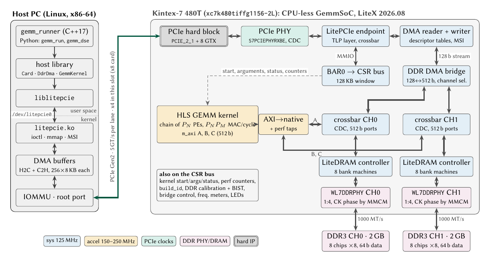
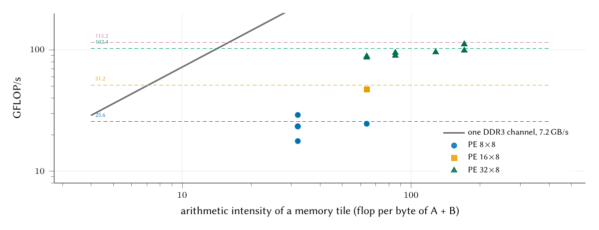
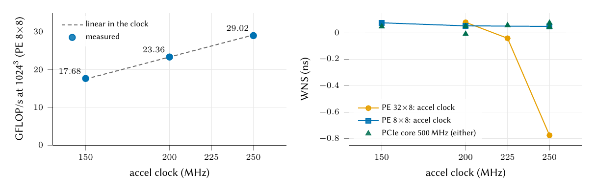

# GEMM accelerator on the DU-PCB-001-003 (LiteX + HLS)

A matrix-multiply accelerator for a Kintex-7 480T PCIe card. An HLS GEMM kernel (adapted from
[spcl/gemm_hls](https://github.com/spcl/gemm_hls)) sits in a CPU-less LiteX SoC. The host sends A and B over PCIe DMA
into two DDR3 channels, the kernel computes C = A·B, and the host reads C back with performance counters. JSON configs
drive the builds (HLS → Vivado → host tools) and the design-space sweeps on the card.



## Results

Best kernel throughput, all results verified exactly on the card:

| Element format | Array, clock | Best measured | DSPs |
|---|---|---|---|
| float32 | PE 32×8, 225 MHz | 110.9 GFLOP/s | 1320 |
| int16 | PE 32×16, 200 MHz | 190.9 GOP/s | 552 |
| int8 | PE 32×32, 225 MHz | 426.6 GOP/s | 40 |
| int4 | PE 64×64, 180 MHz | 1370.9 GOP/s | 38 |

**float32 exploration:** the best result after each step, against the peak of that configuration.


**Roofline:** every float32 build is compute-bound; one DDR3 channel's bandwidth is not the limit.



**Clock:** PE 8×8 throughput scales linearly with the accelerator clock (left). The larger PE 32×8 runs out of timing
slack above 200 MHz with the default Vivado flow (right).



**End to end:** where the time goes on the best float32 build, including the PCIe transfers.


## Quick start

```
python3 setup.litex.du-pcb.py                       # once: LiteX, venv, tool paths
git submodule update --init --recursive             # once: gemm_hls (reference only)
sudo scripts/setup_permissions.sh                   # once: password-less card access

.venv/bin/python scripts/gemm_build.py configs/gemm/default.json                 # build (~15-25 min)
.venv/bin/python scripts/gemm_run.py build/gemm/soc/<build_id> --program \
        --sizes 2048x2048x2048 --verify sampled                                 # load + bring-up + run
.venv/bin/python scripts/gemm_dse.py configs/dse/pe_sweep.json                   # sweep -> results/<campaign>/
```

## Quick Refs

| Topic | Where |
|---|---|
| Accelerator usage: configs, element formats, verification, DDR tuning, outputs, tests | [docs/gemm.md](docs/gemm.md) |
| Base SoC and board: what is in it, setup, daily scripts, things to know | [docs/soc.md](docs/soc.md) |
| Full report (architecture, flow, every measurement): `docs/report/build.sh` → `report.pdf` | [docs/report/](docs/report/) |
| float32 GEMM: plan and progress log | [plan](docs/notes1/gemm-hls-plan.md) · [progress](docs/notes1/gemm-hls-progress.md) |
| Integer and fixed-point formats: plan and progress log | [plan](docs/notes2/int-dtype-plan.md) · [progress](docs/notes2/int-dtype-progress.md) |
| DDR read margin under load (wrong results, root cause, fix) | [misc/int32_verify](misc/int32_verify/README.md) |
| Changes to the upstream HLS kernel | [kernels/gemm/ORIGIN.md](kernels/gemm/ORIGIN.md) |
| Regenerating the README images | `docs/report/tools/export_figures.sh` |
