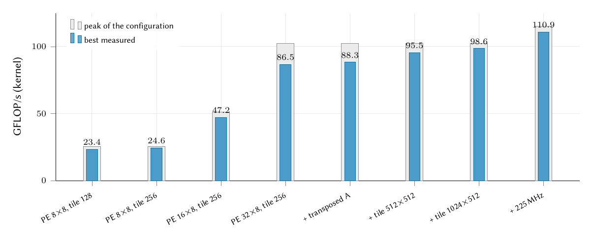
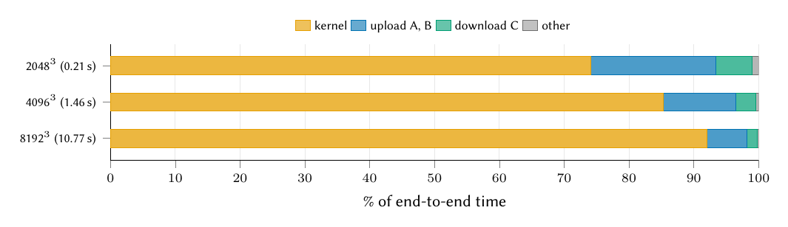

# GEMM accelerator on the DU-PCB-001-003 (LiteX + HLS)

A matrix-multiply accelerator for a Kintex-7 480T PCIe card. An HLS GEMM kernel (adapted from
[spcl/gemm_hls](https://github.com/spcl/gemm_hls)) sits in a CPU-less LiteX SoC. The host sends A and B over PCIe DMA
into two DDR3 channels, the kernel computes C = A·B, and the host reads C back with performance counters. JSON configs
drive the builds (HLS → Vivado → host tools) and the design-space sweeps on the card.


## Results

Best kernel throughput, all results verified exactly on the card:

| Element format | Array, clock | Best measured | DSPs |
|---|---|---|---|
| float32 | PE 32×8, 225 MHz | 110.9 GFLOP/s | 1320 |
| int16 | PE 32×16, 200 MHz | 190.9 GOP/s | 552 |
| int8 | PE 32×32, 225 MHz | 426.6 GOP/s | 40 |
| int4 | PE 64×64, 180 MHz | 1370.9 GOP/s | 38 |

**DenseShift** ([Li et al., ICCV 2023](https://arxiv.org/abs/2208.09708), branch `denseshift`,
[notes](docs/notes3/denseshift-progress.md)): power-of-two weights ±2^e without zero, so a MAC is a shift and an add.
Trained in PyTorch (`ml/denseshift/`) and run on the card with a kernel that has separate A/B/C types
(`kernels/gemm_mixed/`):

| Fastest build per format | Measured (8192³, exact) | vs best float32 × float32 | DSPs | LUTs |
|---|---|---|---|---|
| **Baseline:** float32 × float32, multiply-add, PE 32×8, 225 MHz | 110.9 GFLOP/s | 1× | 1320 | 152.0k |
| float32 × 3-bit DenseShift → float32 (exponent add), PE 32×16, 200 MHz | 189.1 GOP/s | **1.71×** | 1063 | 202.5k |
| int8 × 3-bit DenseShift → int32, shift, PE 32×32, 200 MHz | 375.5 GOP/s | **3.39×** | 40 | 161.6k |
| int8 × 3-bit DenseShift → int16, shift, PE 32×64, 200 MHz | 750.9 GOP/s | **6.77×** | 40 | 190.3k |
| int8 × int8 weights → int32, multiply, PE 32×32, 200 MHz | 375.5 GOP/s | 3.39× | 1064 | 167.5k |

- Each row is the fastest build of its format (array, tile, clock, preset), all measured in one session on the card.
  The float baseline is the fastest float32 build at every size. A float MAC costs ~5 DSPs, so PE 32×8 is the largest
  float array that fits.
- The speedup comes from the array size the DSPs allow. With float activations the multiply becomes an exponent
  add, so twice the MACs fit. With integer activations the MAC needs no DSP: the same speed as an int8 multiply MAC
  with 40 instead of 1064 DSPs and fewer LUTs. The DenseShift builds run at 200 MHz (225 MHz not tried yet).
- CIFAR-10 ResNet-20 (200 epochs, 3 seeds): 3-bit DenseShift 91.3 % against 91.7 % for float32 weights (400 epochs:
  92.05 % against 92.24 %). 4-bit (90.9 %) stays below 3-bit, unlike the paper's ImageNet results
  ([ml/denseshift](ml/denseshift/README.md)).
- An MNIST MLP's two hidden layers on the card, 10 000 images, every sum equal to the CPU's:

  | Activations × weights | Accuracy | Kernel time | Speedup (kernel / end to end) |
  |---|---|---|---|
  | float32 × float32 (baseline, fastest float build) | 98.60 % | 353.1 ms | 1× / 1× |
  | float32 × 3-bit DenseShift | 98.40 % | 212.7 ms | 1.66× / 1.40× |
  | uint8 × 3-bit DenseShift | 98.47 % | 115.7 ms | 3.05× / 2.51× |

  End to end includes the PCIe transfers, which shrink less than the compute (C comes back as 4-byte values).
- Convolutions: DenseShift conv layers are trained (ResNet-20 above, float32 network as the accuracy baseline) but
  have not run on the card in either format.
- With int32 sums, PE 32×32 at 200 MHz is the largest array that closes timing (PE 48×32: routing congestion;
  250 MHz: the HLS dataflow control).
- Verification: the card runs above checked 4098 entries each, exactly. The full screens (every entry of 2 × 2048³)
  and the float PE 40×16 build were stopped when the host ran low on memory and have not been rerun.

**float32 exploration:** the best result after each step, against the peak of that configuration.



**Roofline:** every float32 build is compute-bound; one DDR3 channel's bandwidth is not the limit.


**Clock:** PE 8×8 throughput scales linearly with the accelerator clock (left). The larger PE 32×8 runs out of timing
slack above 200 MHz with the default Vivado flow (right).


**End to end:** where the time goes on the best float32 build, including the PCIe transfers.



## Quick start

```
python3 setup.litex.du-pcb.py                       # once: LiteX, venv, tool paths
git submodule update --init --recursive             # once: gemm_hls (reference only)
sudo scripts/setup_permissions.sh                   # once: password-less card access

.venv/bin/python scripts/gemm_build.py configs/gemm/default.json                 # build (~15-25 min)
.venv/bin/python scripts/gemm_run.py build/gemm/soc/<build_id> --program \
        --sizes 2048x2048x2048 --verify sampled                                 # load + bring-up + run
.venv/bin/python scripts/gemm_dse.py configs/dse/pe_sweep.json                   # sweep -> results/<campaign>/
```

## Quick Refs

| Topic | Where |
|---|---|
| Accelerator usage: configs, element formats, verification, DDR tuning, outputs, tests | [docs/gemm.md](docs/gemm.md) |
| Base SoC and board: what is in it, setup, daily scripts, things to know | [docs/soc.md](docs/soc.md) |
| Full report (architecture, flow, every measurement): `docs/report/build.sh` → `report.pdf` | [docs/report/](docs/report/) |
| float32 GEMM: plan and progress log | [plan](docs/notes1/gemm-hls-plan.md) · [progress](docs/notes1/gemm-hls-progress.md) |
| Integer and fixed-point formats: plan and progress log | [plan](docs/notes2/int-dtype-plan.md) · [progress](docs/notes2/int-dtype-progress.md) |
| DenseShift (power-of-two weights): plan and progress log, PyTorch code, mixed-type kernel | [plan](docs/notes3/denseshift-plan.md) · [progress](docs/notes3/denseshift-progress.md) · [ml/denseshift](ml/denseshift/) · [kernels/gemm_mixed/ORIGIN.md](kernels/gemm_mixed/ORIGIN.md) |
| DDR read margin under load (wrong results, root cause, fix) | [misc/int32_verify](misc/int32_verify/README.md) |
| Changes to the upstream HLS kernel | [kernels/gemm/ORIGIN.md](kernels/gemm/ORIGIN.md) |
| Regenerating the README images | `docs/report/tools/export_figures.sh` |
